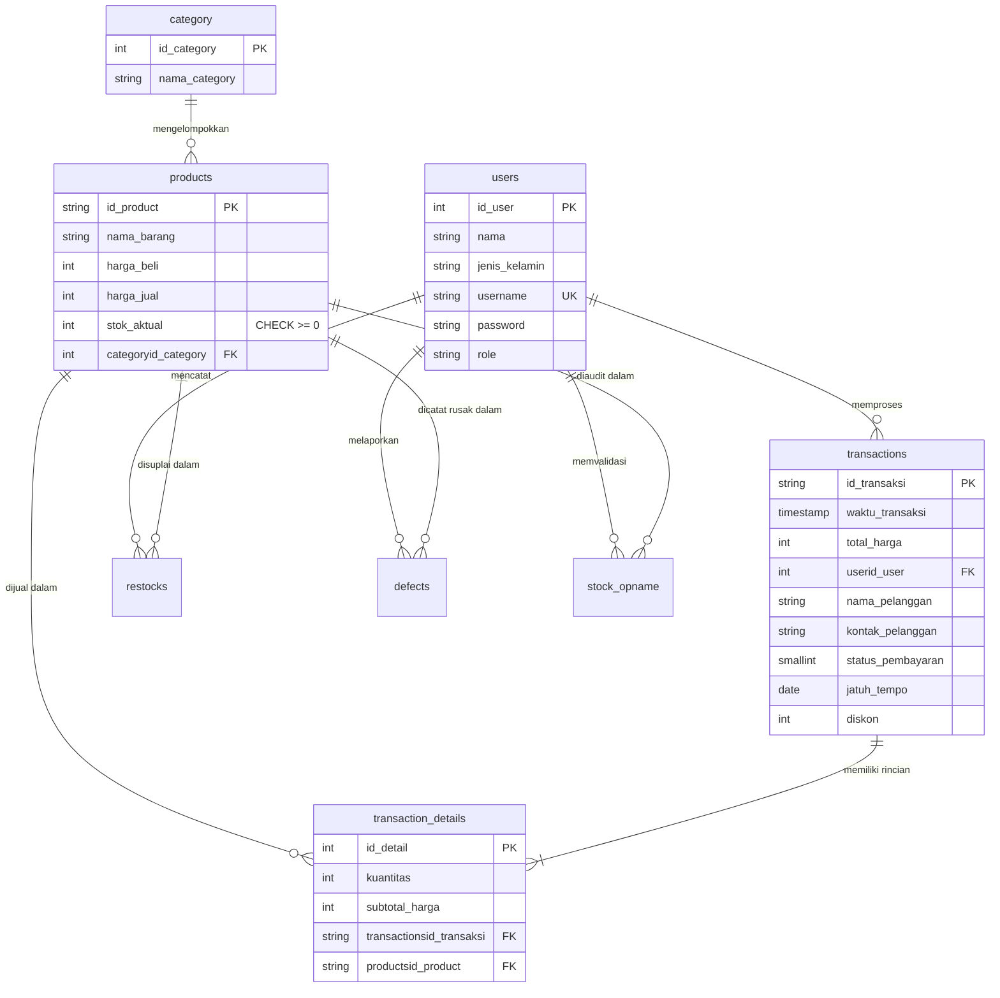
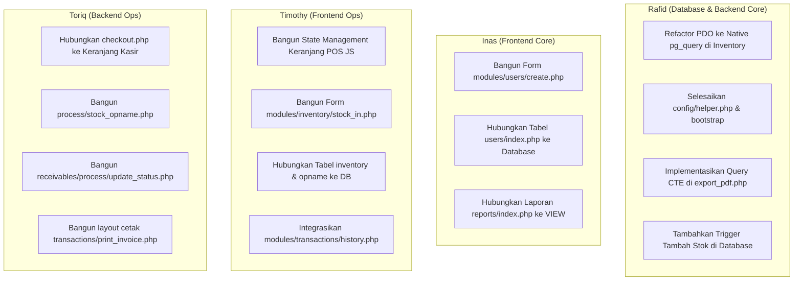

# LAPORAN EVALUASI & AUDIT PROGRES PENGEMBANGAN SISTEM INFORMASI
## SI-DRIPP — SISTEM INFORMASI PENDATAAN STOK & TRANSAKSI HORECA
**Mitra Studi:** CV. Mitra Kembar Pradipta (MKP Store Malang)  
**Mata Kuliah:** Sistem Informasi Manajemen (SIM) & Proyek Basis Data Lanjut (PBL)  
**Periode Evaluasi:** Milestone Tengah Semester (Minggu ke-8)  
**Branch Sumber Audit:** `dev` / `feat/ui-pos-inventory-reports-users`  
**Basis Teknologi:** PHP Prosedural Native + PostgreSQL  

---

## DAFTAR ISI
1. [Ringkasan Eksekutif (Executive Summary)](#1-ringkasan-eksekutif-executive-summary)
2. [Arsitektur Sistem & Spesifikasi Basis Data](#2-arsitektur-sistem--spesifikasi-basis-data)
   - 2.1 Struktur Direktori Proyek (Modular Pattern)
   - 2.2 Audit Skema Database (`docs/sidripp_database.sql`)
   - 2.3 Evaluasi Pemenuhan Syarat Basis Data Lanjut (PBL)
3. [Matriks Status Deliverable per Modul (WBS Tracking)](#3-matriks-status-deliverable-per-modul-wbs-tracking)
4. [Estimasi Persentase Penyelesaian Teknis](#4-estimasi-persentase-penyelesaian-teknis)
   - 4.1 Pembobotan per Komponen (Frontend vs Backend)
   - 4.2 Inventarisasi Bukti Fisik File (Aktif, Statis, dan 0 Byte)
5. [Analisis Kritis Gap Implementasi & Technical Debt](#5-analisis-kritis-gap-implementasi--technical-debt)
   - 5.1 Inkompatibilitas Driver Database (PDO vs Native PostgreSQL)
   - 5.2 Kesalahan Relative Path & Broken Redirect pada Subfolder `process/`
   - 5.3 Pemutusan Integrasi Keranjang POS (`index.php` ↔ `checkout.php`)
   - 5.4 Ketergantungan In-Memory Array pada Modul Piutang
   - 5.5 Ketiadaan Pustaka Helper Universal (`config/helper.php`)
6. [Roadmap Tindak Lanjut & Rekomendasi Sprint](#6-roadmap-tindak-lanjut--rekomendasi-sprint)
   - 6.1 Rencana Aksi per Person in Charge (PIC)
   - 6.2 Target Milestone Minggu ke-9 s.d. Minggu ke-10

---

## 1. Ringkasan Eksekutif (Executive Summary)

Audit teknis ini dilaksanakan untuk mengevaluasi status kemajuan aktual pengembangan perangkat lunak **SI-DRIPP** hingga siklus pengembangan Minggu ke-8. Evaluasi mencakup kelayakan arsitektur perangkat lunak, integritas logika bisnis kasir dan pergudangan HORECA, kepatuhan terhadap dokumen rancangan basis data relasional (3NF), serta pemenuhan kriteria teknis mata kuliah Basis Data Lanjut.

### Ringkasan Temuan Audit:
1. **Status Kesiapan Sistem:** Progres fisik kode saat ini berada pada angka **65%**. Seluruh antarmuka pengguna (Frontend UI) telah berhasil dibangun dan diuji bebas dari *blank screen* (0 byte) dengan standar desain seragam *Bento Grid Toska MKP Store*.
2. **Kesiapan Modul Inti:**
   - **Fondasi Autentikasi (`modules/auth/`) & Master Kategori (`modules/categories/`) & Master Produk (`modules/products/`):** Telah **100% Selesai & Berfungsi Penuh** terhubung ke PostgreSQL.
   - **Modul Transaksi Kasir (`modules/transactions/`), Inventaris (`modules/inventory/`), dan Piutang (`modules/receivables/`):** Masih berada dalam status **Transisi Frontend ke Backend**; sebagian besar logika UI masih mengandalkan data simulasi/mockup dan membutuhkan sinkronisasi ke tabel database fisik.
3. **Temuan Kritis (High Priority Technical Debt):** Ditemukan inkonsistensi penggunaan ekstensi basis data pada file proses inventaris (`stock_in.php` dan `defects.php`) yang ditulis menggunakan objek **PDO**, bertentangan dengan arsitektur utama aplikasi yang menggunakan **Native PostgreSQL (`pg_connect`)**.

---

## 2. Arsitektur Sistem & Spesifikasi Basis Data

### 2.1 Struktur Direktori Proyek (Modular Pattern)
SI-DRIPP mengadopsi pola arsitektur **Modular Monolith Prosedural** untuk memisahkan domain antarmuka dari skrip pemrosesan data tanpa menggunakan paradigma OOP/Framework yang kompleks:

```text
SI-DRIPP/
├── .github/                  # CI/CD Workflows (Linting PHP 8.1 & Auto-reviewer)
├── assets/                   # Aset Frontend Mandiri
│   ├── css/style.css         # Design System Soft UI Bento Grid Toska (Pure CSS)
│   ├── js/app.js             # Skrip interaksi client-side & modal toggle
│   └── img/Logo.jpeg         # Identitas visual MKP Store
├── config/                   # Konfigurasi Inti
│   ├── database.php          # Koneksi native PostgreSQL (pg_connect)
│   ├── bootstrap.php         # Inisialisasi sesi, BASE_URL dinamis, & BASE_PATH
│   ├── auth_guard.php        # Middleware sesi & RBAC (Role-Based Access Control)
│   └── helper.php            # (Kosong - 0 Byte) Pustaka fungsi universal
├── docs/                     # Dokumentasi Desain
│   └── sidripp_database.sql  # DDL Skema PostgreSQL, Trigger, dan View
├── layouts/                  # Komponen Kerangka Halaman
│   ├── header.php            # Head HTML, Topbar, Status Profil, & Role Switcher
│   ├── sidebar.php           # Navigasi bertingkat berbasis hak akses role
│   ├── footer.php            # Penutup dokumen & pemuatan skrip JS
│   └── mock_data.php         # Generator SVG botol sirup & utilitas prototype
└── modules/                  # Direktori Fitur Bisnis
    ├── auth/                 # Form login & penanganan sesi
    ├── categories/           # Full CRUD Kategori Produk
    ├── products/             # Full CRUD Master Katalog Produk
    ├── users/                # Manajemen akun personel & RBAC
    ├── transactions/         # Kasir POS, keranjang belanja, & arsip nota
    ├── inventory/            # Manajemen stok gudang, restock, defect, & opname
    ├── receivables/          # Pengawasan Term of Payment & integrasi WhatsApp
    ├── dashboard/            # Bento grid statistik omzet & ringkasan operasional
    └── reports/              # Rekapitulasi penjualan & estimasi laba kotor
```

---

### 2.2 Audit Skema Database (`docs/sidripp_database.sql`)
Skema PostgreSQL saat ini terdiri dari **8 tabel**, **1 VIEW**, dan **1 TRIGGER** yang saling berelasi:



#### Rincian Spesifikasi Skema Database:
1. **Integritas Constraint:**
   - **Primary Key (PK) & Foreign Key (FK):** Diterapkan pada seluruh tabel dengan opsi relasional `ON DELETE CASCADE` untuk menjaga integritas referensial.
   - **Constraint Tambahan:** 
     - `UNIQUE(username)` pada tabel `users` untuk menjamin tidak ada duplikasi akun petugas.
     - `CHECK(stok_aktual >= 0)` pada tabel `products` sebagai benteng validasi agar stok fisik tidak bernilai negatif.
2. **Objek VIEW (`v_laporan_penjualan`):**
   - Merelasikan 4 tabel (`transaction_details`, `transactions`, `products`, `users`) untuk kebutuhan analitik penjualan harian tanpa membebani aplikasi dengan *query join* berulang.
3. **Objek FUNGSI & TRIGGER:**
   - **Fungsi PL/pgSQL:** `kurangi_stok_otomatis()`
   - **Trigger:** `trigger_kurangi_stok` yang berjalan otomatis `AFTER INSERT ON transaction_details` untuk mengurangi `products.stok_aktual` secara atomik di sisi server database.

---

### 2.3 Evaluasi Pemenuhan Syarat Basis Data Lanjut (PBL)

| Kriteria Syarat PBL | Status Implementasi | Bukti Teknis pada Kode / SQL | Keterangan Evaluasi |
| :--- | :---: | :--- | :--- |
| **1. Skema Relasional Min. 3–5 Entitas (3NF)** | **TERPENUHI** | 8 Tabel di [docs/sidripp_database.sql](file:///C:/Users/IdeaPad/Documents/SEMESTER%203/PBL/SI-DRIPP-Antigravity/docs/sidripp_database.sql#L1-L75). Relasi many-to-many produk-transaksi dinormalisasi lewat `transaction_details`. | Struktur tabel telah memenuhi normalisasi bentuk ketiga (3NF) tanpa dependensi transitif. |
| **2. Constraint Wajib (PK/FK) & Tambahan** | **TERPENUHI** | PK, FK, `UNIQUE(username)`, `CHECK(stok_aktual >= 0)`, `NOT NULL` terpasang di seluruh kolom vital. | Integritas data terlindungi di level engine PostgreSQL. |
| **3. Minimal 1 VIEW Database** | **TERPENUHI (SQL)**<br>*Belum Terserap App* | View `v_laporan_penjualan` terdefinisi di [docs/sidripp_database.sql](file:///C:/Users/IdeaPad/Documents/SEMESTER%203/PBL/SI-DRIPP-Antigravity/docs/sidripp_database.sql#L77-L89). | File `modules/reports/index.php` belum memanggil View ini (masih menggunakan tabel statis). |
| **4. Minimal 1 Trigger / Stored Procedure** | **TERPENUHI (SQL)** | Trigger `trigger_kurangi_stok` dan fungsi `kurangi_stok_otomatis()` di [docs/sidripp_database.sql](file:///C:/Users/IdeaPad/Documents/SEMESTER%203/PBL/SI-DRIPP-Antigravity/docs/sidripp_database.sql#L91-L104). | Berfungsi memotong stok saat transaksi kasir berhasil dicatat. |
| **5. Query Kompleks (Join, Agregasi, Subquery, CTE)** | **PARSIAL (30%)** | Multi-table JOIN terpasang di `products/index.php` dan View; Agregasi `COUNT` terpasang di Dashboard. | Belum ada pemanfaatan **Common Table Expression (CTE)** (`WITH ... AS`) dan klausa `GROUP BY / HAVING` pada modul laporan. |

---

## 3. Matriks Status Deliverable per Modul (WBS Tracking)

Matriks berikut menguraikan status operasional per komponen kode yang diverifikasi langsung dari branch pengembangan:

| Kode WBS | Modul Deliverable | Berkas Terkait | Status Kesiapan | Temuan & Analisis Teknis |
| :---: | :--- | :--- | :---: | :--- |
| **WBS-01** | **Core & Konfigurasi** | `config/database.php`<br>`config/bootstrap.php`<br>`config/auth_guard.php`<br>`config/helper.php` | **Perlu Refactoring** | Koneksi `pg_connect` berjalan baik. Namun `config/helper.php` masih berukuran **0 byte**, menyebabkan fungsi format mata uang dan tanggal masih menumpang di file mockup layout. |
| **WBS-02** | **Autentikasi Pengguna** | `modules/auth/login.php`<br>`modules/auth/process/login.php`<br>`modules/auth/process/logout.php` | **Selesai Penuh** | Alur login form tervalidasi via `pg_query_params`, proteksi password menggunakan `password_verify()`, inisialisasi sesi `id_user` & `role` berfungsi penuh. |
| **WBS-03** | **Master Kategori** | `modules/categories/index.php`<br>`modules/categories/create.php`<br>`modules/categories/process/create.php` | **Selesai Penuh** | Siklus Full CRUD berjalan langsung ke tabel `category`. Mendukung operasi Tambah, Edit (`?edit=id`), dan Hapus (`?hapus_id=id`) dengan penanganan error foreign key. |
| **WBS-04** | **Master Katalog Produk** | `modules/products/index.php`<br>`modules/products/create.php`<br>`modules/products/process/create.php` | **Selesai Penuh** | Katalog terhubung relasi `LEFT JOIN category`. Form tambah & edit mendukung input dropdown dinamis, harga beli, harga jual, dan stok awal (`stok_aktual`). |
| **WBS-05** | **Manajemen Akun (Users)** | `modules/users/index.php`<br>`modules/users/create.php`<br>`modules/users/process/create.php` | **UI Statis** | Halaman daftar pengguna masih menampilkan data dummy (Zicco, Zulfikar, Daffa); `create.php` masih **0 byte**. Logika `password_hash()` di `process/create.php` belum tersambung ke form. |
| **WBS-06** | **Operasional Gudang** | `modules/inventory/index.php`<br>`modules/inventory/stock_in.php`<br>`modules/inventory/defect.php`<br>`modules/inventory/opname.php`<br>`modules/inventory/process/*` | **Perlu Refactoring Fatal** | UI gudang, barang defect, dan opname berstatus statis; `stock_in.php` **0 byte**. File `process/stock_in.php` dan `process/defects.php` **fatal error** akibat memanggil `$pdo` dan path include salah. |
| **WBS-07** | **Kasir / POS & Transaksi** | `modules/transactions/index.php`<br>`modules/transactions/history.php`<br>`modules/transactions/print_invoice.php`<br>`modules/transactions/process/checkout.php` | **UI Statis / Logika Parsial** | UI POS dan riwayat nota menggunakan data dummy statis. Script `process/checkout.php` sudah siap dengan kontrol transaksi ACID (`BEGIN/COMMIT`), namun belum terhubung ke keranjang belanja interaktif. |
| **WBS-08** | **Manajemen Piutang (TOP)** | `modules/receivables/index.php`<br>`modules/receivables/process/update_status.php` | **UI Statis** | Antarmuka monitoring jatuh tempo dan generator pesan WhatsApp sangat lengkap, namun seluruh data masih dibaca dari array PHP lokal `$piutang_raw`. File pembaruan status lunas masih **0 byte**. |
| **WBS-09** | **Dashboard & Laporan** | `modules/dashboard/index.php`<br>`modules/reports/index.php`<br>`modules/reports/process/export_pdf.php`<br>`modules/reports/process/delete_report.php` | **UI Statis / Dashboard Parsial** | Kartu ringkasan statistik Dashboard sudah mengambil data `COUNT(*)` asli dari database. Halaman laporan penjualan masih berstatus tabel mockup HTML; file ekspor PDF masih **0 byte**. |

---

## 4. Estimasi Persentase Penyelesaian Teknis

### 4.1 Pembobotan per Komponen (Frontend vs Backend)
Perhitungan kemajuan fisik didasarkan pada bobot 50% untuk ketersediaan dan kesiapan antarmuka pengguna (Frontend) dan 50% untuk integritas logika pemrosesan database PostgreSQL (Backend):

```text
===================================================================================
KOMPONEN SISTEM            BOBOT MODUL   FRONTEND (50%)   BACKEND (50%)   PROGRES
===================================================================================
1. Core & Konfigurasi          10%            100%             70%          85.0%
2. Autentikasi Pengguna        10%            100%            100%         100.0%
3. Master Kategori Produk      10%            100%            100%         100.0%
4. Master Katalog Produk       15%            100%            100%         100.0%
5. Master Pengguna (Users)     10%             50%             40%          45.0%
6. Operasional Gudang          15%             40%             30%          35.0%
7. Transaksi Kasir (POS)       15%             60%             40%          50.0%
8. Manajemen Piutang (TOP)      7%             70%             10%          40.0%
9. Dashboard & Laporan Keu.     8%             60%             30%          45.0%
===================================================================================
TOTAL PROGRES TEKNIS KESELURUHAN (STATUS AKTUAL MINGGU KE-8)              65.0%
===================================================================================
```

---

### 4.2 Inventarisasi Bukti Fisik File

#### A. Kategori File Fungsional & Dinamis (Siap Operasional):
- `config/database.php` (940 byte) & `config/bootstrap.php` (1.892 byte)
- `config/auth_guard.php` (805 byte)
- `modules/auth/login.php` (3.811 byte), `process/login.php` (2.350 byte), `process/logout.php` (1.080 byte)
- `modules/categories/index.php` (3.726 byte), `create.php` (3.010 byte), `process/create.php` (2.100 byte)
- `modules/products/index.php` (5.547 byte), `create.php` (5.915 byte), `process/create.php` (2.640 byte)
- `modules/dashboard/index.php` (2.861 byte - query `COUNT` langsung ke PostgreSQL)
- `modules/transactions/process/checkout.php` (2.479 byte - Transaksi multi-item ACID)

#### B. Kategori File Antarmuka Statis (Mockup):
- `modules/users/index.php` (5.140 byte - daftar akun dummy)
- `modules/transactions/index.php` (11.005 byte - kartu POS & keranjang statis)
- `modules/transactions/history.php` (4.816 byte - tabel invoice statis)
- `modules/receivables/index.php` (29.715 byte - array data `$piutang_raw`)
- `modules/inventory/index.php` (4.260 byte), `defect.php` (4.893 byte), `opname.php` (5.450 byte)
- `modules/reports/index.php` (5.909 byte - rekapitulasi penjualan statis)

#### C. Kategori File Belum Dikerjakan / Kosong (0 Byte):
- `config/helper.php` (0 byte)
- `modules/users/create.php` (0 byte)
- `modules/inventory/stock_in.php` (0 byte)
- `modules/inventory/process/stock_opname.php` (0 byte)
- `modules/transactions/print_invoice.php` (0 byte)
- `modules/receivables/process/update_status.php` (0 byte)
- `modules/reports/process/export_pdf.php` (0 byte)
- `modules/reports/process/delete_report.php` (0 byte)

---

## 5. Analisis Kritis Gap Implementasi & Technical Debt

### 5.1 Inkompatibilitas Driver Database (PDO vs Native PostgreSQL)
> [!CAUTION]
> **Tingkat Keparahan: KRITIS (System Fatal Error)**
- **Kondisi Aktual:** File backend pergudangan `modules/inventory/process/stock_in.php` dan `modules/inventory/process/defects.php` ditulis menggunakan antarmuka PDO:
  ```php
  $pdo->setAttribute(PDO::ATTR_ERRMODE, PDO::ERRMODE_EXCEPTION);
  $pdo->beginTransaction();
  $stmt = $pdo->prepare('INSERT INTO restocks ...');
  ```
- **Akar Masalah:** File arsitektur `config/database.php` menginisialisasi resource koneksi native menggunakan `pg_connect()` yang disimpan ke dalam variabel `$conn`. Objek `$pdo` tidak pernah dideklarasikan di seluruh aplikasi.
- **Dampak:** Begitu pengguna menekan tombol simpan form restock atau defect, PHP runtime akan melempar error fatal: `Fatal error: Uncaught Error: Undefined variable $pdo`.
- **Rencana Tindakan:** Lakukan refactoring menyeluruh pada kedua file tersebut menggunakan `pg_query($conn, "BEGIN")`, `pg_query_params($conn, ...)`, dan `pg_query($conn, "COMMIT")`.

---

### 5.2 Kesalahan Relative Path & Broken Redirect pada Subfolder `process/`
> [!WARNING]
> **Tingkat Keparahan: TINGGI (File Inclusion Failure & 404 Not Found)**
- **Kondisi Aktual:** Pada baris ke-4 file `modules/inventory/process/stock_in.php` dan `defects.php`:
  ```php
  require_once __DIR__ . '/../../config/bootstrap.php';
  ```
- **Akar Masalah:** Folder `process/` berada pada kedalaman 3 tingkat dari root (`modules/inventory/process/`). Penggunaan `/../../` hanya mundur 2 tingkat, mengarah ke `modules/config/bootstrap.php` yang tidak pernah ada. Jalur yang benar adalah `/../../../config/bootstrap.php`.
- **Kesalahan Redirect:** Baris pengalihan sukses/gagal mendefinisikan:
  ```php
  $halaman_form = BASE_URL . 'inventory/stock_in.php';
  ```
  Ini menyebabkan browser diarahkan ke URL tanpa subfolder `modules/`, menghasilkan status HTTP **404 Not Found**.

---

### 5.3 Pemutusan Integrasi Keranjang POS (`index.php` ↔ `checkout.php`)
> [!IMPORTANT]
> **Tingkat Keparahan: TINGGI (Transaksi Bisnis Terhenti)**
- **Kondisi Aktual:** Modul backend `modules/transactions/process/checkout.php` telah dirancang dengan kontrol transaksi ACID yang sangat matang untuk memproses data array POST `product_id[]`, `kuantitas[]`, dan `harga[]`.
- **Akar Masalah:** Antarmuka kasir `modules/transactions/index.php` belum memiliki skrip JavaScript yang secara dinamis menambahkan produk pilihan kasir ke dalam elemen `<form method="POST">`. Tombol "Tambah" pada kartu produk saat ini baru menampilkan dialog `alert()`.
- **Rencana Tindakan:** Tambahkan skrip state management keranjang sederhana (berbasis array JavaScript lokal) untuk merender elemen input tersembunyi (*hidden inputs*) sebelum form disubmit ke `process/checkout.php`.

---

### 5.4 Ketergantungan In-Memory Array pada Modul Piutang
> [!NOTE]
> **Tingkat Keparahan: SEDANG (Integritas Data Transaksional)**
- **Kondisi Aktual:** Halaman [modules/receivables/index.php](file:///C:/Users/IdeaPad/Documents/SEMESTER%203/PBL/SI-DRIPP-Antigravity/modules/receivables/index.php) memiliki antarmuka yang sangat representatif untuk kebutuhan monitoring Term of Payment (TOP) mitra HORECA Malang. Namun, 100% data tabelnya diambil dari array statis `$piutang_raw`.
- **Rencana Tindakan:** Ganti sumber data tabel dengan query dinamis ke basis data:
  ```sql
  SELECT t.*, u.nama AS petugas 
  FROM transactions t 
  JOIN users u ON t.userid_user = u.id_user 
  WHERE t.status_pembayaran = 2 
  ORDER BY t.jatuh_tempo ASC;
  ```
  Serta hidupkan file [modules/receivables/process/update_status.php](file:///C:/Users/IdeaPad/Documents/SEMESTER%203/PBL/SI-DRIPP-Antigravity/modules/receivables/process/update_status.php) untuk mengubah status piutang menjadi lunas (`status_pembayaran = 1`).

---

### 5.5 Ketiadaan Pustaka Helper Universal (`config/helper.php`)
> [!NOTE]
> **Tingkat Keparahan: RENDAH (Standarisasi Kode)**
- **Kondisi Aktual:** File `config/helper.php` masih berukuran **0 byte**. Akibatnya, fungsi penting seperti pemformatan mata uang `rupiah()`, formatting tanggal Indonesia `tgl_id()`, dan sanitasi `e()` saat ini menumpang pada file `layouts/mock_data.php`.
- **Rencana Tindakan:** Migrasikan fungsi-fungsi utilitas prosedural tersebut ke dalam `config/helper.php` agar sistem memiliki dependensi pustaka yang bersih dan mandiri.

---

## 6. Roadmap Tindak Lanjut & Rekomendasi Sprint

Untuk memastikan penyelesaian 100% pada Milestone Akhir (Minggu ke-10), pembagian beban kerja didistribusikan secara terfokus kepada seluruh Person in Charge (PIC):

### 6.1 Rencana Aksi per Person in Charge (PIC)



---

### 6.2 Target Milestone Penyelesaian

| Target Waktu | Fokus Deliverable | Kriteria Kesiapan (Acceptance Criteria) |
| :---: | :--- | :--- |
| **Minggu ke-9 (Sprint 1)** | **Penyelesaian Gap Kritis & Transaksi Kasir** | 1. File `stock_in.php` dan `defects.php` bebas dari PDO dan syntax error.<br>2. Siklus kasir POS (pilih barang $\rightarrow$ keranjang JS $\rightarrow$ submit `checkout.php` $\rightarrow$ trigger potong stok database) teruji 100%.<br>3. `config/helper.php` terisi dan aktif. |
| **Minggu ke-10 (Sprint 2)** | **Pelunasan Piutang & Analitik PBL** | 1. Modul piutang membaca data transaksi tempo dan tombol pelunasan berfungsi.<br>2. Modul laporan penjualan mengonsumsi database VIEW dan query analitik **Common Table Expression (CTE)** diekspor ke PDF.<br>3. Skema database, trigger restock, dan seluruh dokumen teknis siap untuk penilaian final SIM & PBL. |

---

**Disusun oleh:** Senior Tech Lead & System Analyst  
**Distribusi:** Tim Pengembang SI-DRIPP (Kelompok 404), Dosen Pengampu SIM, & Dosen Penguji Basis Data Lanjut (PBL)  
**Status Dokumen:** *APPROVED FOR WBS & TRACKING RELEASE*
