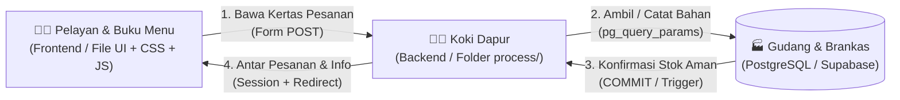

# 📘 BUKU SAKU & PANDUAN BELAJAR KODE SI-DRIPP (KELOMPOK 404)
**Proyek:** Sistem Informasi Pendataan Stok dan Transaksi HORECA — CV. Mitra Kembar Pradipta (MKP Store Malang)  
**Target Pembaca:** Tim Pengembang Mahasiswa Semester 3 (**Rafid, Toriq, Inas, & Timothy**)  
**Paradigma Aplikasi:** PHP Native Prosedural Modular + PostgreSQL (Supabase Cloud)

---

> **Pesan Pembuka dari Mentor:**  
> Halo teman-teman **Kelompok 404**! 👋  
> Dokumen ini sengaja ditulis dengan bahasa santai supaya kalian berempat nggak pusing saat baca kodingan proyek kita. Anggap saja dokumen ini sebagai "contekan pintar" sebelum kita maju presentasi atau sidang evaluasi PBL di depan dosen. Kalau kalian paham isi dokumen ini dari atas sampai bawah, dijamin kalian bakal bisa menjawab pertanyaan dosen dengan lancar dan penuh percaya diri!

---

## 1. Konsep Dasar & Analogi Sistem (Mental Model)

Sebelum menghafal kode PHP atau SQL, bayangkan dulu aplikasi **SI-DRIPP** ini seperti sebuah **Restoran Kafe / Gudang Distribusi Sirup (HORECA)** di dunia nyata.



### Analogi 3 Komponen Utama Kita:
1. **Frontend / UI (`modules/.../index.php`, `create.php`, `style.css`, `app.js`) = Pelayan & Buku Menu**
   - Tugasnya tampil rapi di depan pelanggan/kasir, menampilkan daftar sirup DRIPP di layar, dan menyediakan formulir isian.
   - **Aturan penting:** Pelayan hanya bertugas mencatat pesanan di kertas formulir (`<form>`) lalu menyerahkannya ke dapur. Pelayan **tidak boleh memasak sendiri** di meja tamu!
2. **Backend (`modules/.../process/*.php`) = Koki di Dapur Tertutup**
   - Begitu pelayan menyerahkan kertas pesanan (`$_POST`), Koki di dalam folder `process/` langsung memeriksa apakah pesanan itu valid, menghitung total harga, lalu mengambil/menyimpan data ke gudang.
   - Karena koki bekerja di dapur belakang, **di dalam file `process/` sama sekali tidak ada tampilan warna-warni atau tag HTML**. Setelah selesai memasak, koki menitipkan pesan status (`$_SESSION['success']`) dan menyuruh pelayan kembali ke ruang depan (`header("Location: ...")`).
3. **Database Cloud (`PostgreSQL di Supabase`) = Gudang Bahan Baku & Buku Besar Toko**
   - Semua catatan stok botol sirup, daftar harga, akun pegawai, hingga nota piutang disimpan di satu brankas pusat di internet (Supabase).
   - Brankas ini juga punya "satpam otomatis" bernama **Constraint** (misal: stok tidak boleh minus `CHECK (stok_aktual >= 0)`) dan **Trigger** (begitu barang terjual, stok gudang otomatis dipotong oleh sistem database).

---

### 💡 Kenapa Kita Pakai "PHP Native Prosedural Murni" (Tanpa OOP & Tanpa Framework)?

Di aturan proyek kita, kita dilarang memakai `class`, `object` (OOP), maupun framework seperti Laravel. Kalian mungkin bertanya: *"Kenapa sih kita pakai PHP Prosedural?"*

Kalau ditanya dosen, ini **3 alasan ilmiah & praktisnya**:
1. **Alur Eksekusi Linier (Top-to-Bottom Execution):**  
   Kode prosedural dibaca oleh komputer (dan manusia) lurus dari baris ke-1 sampai baris terakhir. Sangat transparan untuk memvalidasi alur bisnis kasir dan gudang tanpa tersembunyi di balik *magic* milik framework.
2. **Zero Overhead & Ringan:**  
   Tidak perlu memuat ratusan file *library* hanya untuk menjalankan satu query `INSERT` atau `SELECT`. Aplikasi berjalan sangat cepat.
3. **Fokus pada Penguasaan Fundamental Basis Data Lanjut (PBL):**  
   Karena tidak dibantu *ORM* (seperti Eloquent di Laravel), kita benar-benar menulis dan mengendalikan sendiri query SQL murni: mulai dari **JOIN, GROUP BY, HAVING, Subquery, CTE (`WITH ... AS`), VIEW, hingga Transaksi ACID (`BEGIN`, `COMMIT`, `ROLLBACK`)**.

---

## 2. Peta Pembagian Pemahaman per Anggota Tim

Supaya belajarnya fokus, silakan pelajari bagian umum ditambah **bagian khusus sesuai nama kalian** di bawah ini:

---

### 👨‍💻 A. Fokus Pemahaman TORIQ (Backend & Quality Assurance)
*File pegangan utama: Semua file di dalam `modules/*/process/*.php`*

#### 1. Kenapa di dalam folder `process/` TIDAK BOLEH ada tag HTML?
File di dalam folder `process/` (seperti `modules/transactions/process/checkout.php` atau `modules/inventory/process/stock_in.php`) adalah **mesin pemroses murni**.
- Di akhir file `process/`, kita selalu memanggil fungsi `header("Location: ../index.php")` untuk memindahkan halaman (redirect).
- Di PHP, fungsi `header("Location: ...")` **akan langsung error (*Headers already sent*)** kalau di atasnya ada satu huruf saja tag HTML atau `echo` yang tercetak ke layar.
- Selain itu, memisahkan file UI dan file `process/` menerapkan prinsip **Separation of Concerns (Pemisahan Tanggung Jawab)** dan pola **PRG (Post/Redirect/Get)** agar ketika user menekan tombol *Refresh (F5)* di browser, data tidak terkirim dua kali (double submit).

#### 2. Kenapa WAJIB pakai `pg_query_params()` dan BUKAN `pg_query()` biasa saat menerima input user?
Coba bandingkan dua potongan kode ini:

```php
// ❌ BAHAYA (Rawan SQL Injection):
// Jika user mengisi $username dengan: admin' OR '1'='1
$sql = "SELECT * FROM users WHERE username = '$username'";
$res = pg_query($conn, $sql);

// ✅ AMAN (Standar SI-DRIPP menggunakan Prepared Statement):
$sql = "SELECT * FROM users WHERE username = $1";
$res = pg_query_params($conn, $sql, [$username]);
```
- Pada `pg_query_params()`, tanda `$1`, `$2`, `$3` adalah **placeholder (titik-titik kosong)**.
- Perintah SQL dan data input user dikirim ke PostgreSQL melalui **dua jalur terpisah**. Walaupun hacker mengetikkan karakter kutip `'` atau perintah `DROP TABLE` di kolom input, PostgreSQL hanya akan menganggapnya sebagai **teks biasa**, bukan perintah SQL!

#### 3. Logika Transaksi Database: `BEGIN`, `COMMIT`, dan `ROLLBACK` (Prinsip ACID)
Bayangkan saat kasir menekan tombol **Checkout** untuk 3 jenis botol sirup di `modules/transactions/process/checkout.php`:
1. Sistem harus menyimpan 1 baris nota utama ke tabel `transactions`.
2. Sistem harus menyimpan 3 baris rincian barang ke tabel `transaction_details` (dan memotong stok masing-masing botol).

**Apa jadinya kalau botol ke-1 dan ke-2 berhasil disimpan, tapi saat botol ke-3 tiba-tiba stoknya tidak cukup atau sinyal terputus?**
Tanpa transaksi database, nota dan potongan stok botol 1 & 2 sudah terlanjur masuk ke database, padahal transaksinya gagal! Data toko langsung kacau.

Itulah gunanya blok transaksi di kode kita:
```php
pg_query($conn, "BEGIN"); // 1. Buka mode "Semua Berhasil atau Batal Semua"

try {
    // Eksekusi INSERT ke tabel transactions
    // Eksekusi INSERT ke tabel transaction_details (di dalam perulangan)
    
    pg_query($conn, "COMMIT"); // 2. Kalau semua aman 100%, kunci permanen ke database!
} catch (Exception $e) {
    pg_query($conn, "ROLLBACK"); // 3. Kalau ada 1 saja yang gagal, batalkan semuanya seperti belum pernah terjadi apa-apa!
}
```

#### 4. Cara Kerja Session Login (`$_SESSION['id_user']` & `$_SESSION['role']`)
HTTP (protokol web) itu sifatnya *stateless* (pelupa) — begitu pindah halaman, browser lupa siapa yang barusan login.
- Saat user berhasil login di `modules/auth/process/login.php` (setelah lulus `password_verify()`), kita menyimpan identitasnya di memori server menggunakan variabel superglobal `$_SESSION`:
  ```php
  $_SESSION['id_user']  = $user['id_user'];
  $_SESSION['username'] = $user['username'];
  $_SESSION['role']     = $user['role']; // misal: 'super_admin', 'admin', 'kasir', 'staf_gudang'
  ```
- Setiap kali user membuka halaman lain, file `config/auth_guard.php` akan memeriksa:
  1. Apakah `$_SESSION['id_user']` ada isinya? Kalau kosong (belum login), tendang balik ke `login.php`.
  2. Apakah `$_SESSION['role']` boleh masuk ke halaman ini (lewat fungsi `cek_hak_akses()`)? Misalnya, Kasir coba-coba buka halaman Laporan Keuangan milik Owner (`super_admin`), maka sistem otomatis menolak aksesnya!

---

### 🎨 B. Fokus Pemahaman INAS & TIMOTHY (Frontend & UI/UX)
*File pegangan utama: `modules/*/index.php`, `create.php`, `layouts/*`, `assets/css/style.css`, `assets/js/app.js`*

#### 1. Bagaimana Form HTML Mengirim Data ke Folder `process/`?
Di setiap halaman input (seperti `modules/products/create.php` atau `modules/inventory/stock_in.php`), ada 3 atribut kunci pada tag `<form>`:

```html
<form action="process/create.php" method="POST">
    <input type="text" name="nama_barang" required>
    <input type="number" name="harga_jual" required>
    <button type="submit">Simpan Produk</button>
</form>
```
1. `action="process/create.php"`: Alamat tujuan ke mana paket data akan dikirim saat tombol `submit` ditekan.
2. `method="POST"`: Data dikirim secara tertutup di dalam *body request* HTTP (tidak nongol di URL browser), sehingga aman untuk mengirim password atau data form yang panjang.
3. `name="nama_barang"`: **Label amplop data!** Nama di atribut `name="..."` inilah yang akan ditangkap oleh Toriq di backend lewat variabel `$_POST['nama_barang']`. Kalau atribut `name` di HTML salah ketik, backend tidak akan menerima datanya!

#### 2. Cara PHP Mencetak Data dari Database ke Tabel HTML (`while ($row = pg_fetch_assoc(...))`)
Saat kita mengambil daftar produk atau kategori menggunakan `pg_query()`, hasilnya masih berupa bungkusan data mentah di memori (`$result`). Untuk menampilkannya menjadi baris-baris tabel HTML (`<tr>`), kita menggunakan perulangan `while` dan `pg_fetch_assoc()`:

```php
<?php
$no = 1;
// pg_fetch_assoc mengambil 1 baris data sebagai array asosiatif, lalu menggeser penunjuk ke baris berikutnya.
// Kalau barisnya sudah habis, dia menghasilkan false dan perulangan while otomatis berhenti!
while ($row = pg_fetch_assoc($result)): 
?>
    <tr>
        <td><?= $no++ ?></td>
        <td><strong><?= e($row['nama_barang']) ?></strong></td>
        <td><?= rupiah($row['harga_jual']) ?></td>
    </tr>
<?php endwhile; ?>
```
> **Catatan Penting:** Kenapa kita membungkus teks dengan fungsi `e($row['nama_barang'])` atau `htmlspecialchars()`? Supaya kalau ada nama barang yang mengandung karakter `<script>`, karakter itu tidak dieksekusi sebagai program jahat oleh browser (**Pencegahan serangan XSS / Cross-Site Scripting**).

#### 3. Kenapa Inline CSS (`style="..."`) Wajib Dihapus & Dipindah ke `assets/css/style.css`?
Sebelumnya ada elemen yang ditulis seperti `<div style="color: red; padding: 20px;">`. Sekarang semuanya sudah kita ubah menjadi class seperti `<div class="callout danger">`. Alasannya:
1. **Clean Architecture & Separation of Concerns:** File `.php` hanya fokus mengurus struktur HTML & data, sedangkan urusan warna, jarak, dan ukuran huruf 100% diurus oleh `assets/css/style.css`.
2. **Kemudahan Maintenance (Satu titik ubah untuk semua halaman):** Kalau dosen minta warna merah *error* diubah sedikit saja, kita cukup mengubah 1 baris di `style.css` (`--danger`), tidak perlu mengedit 25 file PHP satu per satu!
3. **Konsistensi Desain Bento Grid Toska MKP Store:** Semua kartu menggunakan `.card`, semua tabel menggunakan `.table`, dan semua tombol menggunakan `.btn-primary`.

#### 4. Logika Interaksi JavaScript (Keranjang Kasir POS & Filter Pencarian)
Di halaman Kasir (`modules/transactions/index.php`), kenapa kita pakai JavaScript untuk keranjang belanja?
- Kalau setiap kali kasir klik tombol **"+ Tambah"** botol sirup halaman web harus *reload* bolak-balik ke server, kasir akan bekerja sangat lambat.
- Dengan JavaScript (`tambahKeKeranjang()` & `renderKeranjang()`):
  1. Daftar barang yang dipilih disimpan sementara di variabel array JavaScript `let keranjang = []` di memori browser.
  2. Setiap ada barang ditambah/dikurangi, fungsi `renderKeranjang()` langsung menghitung ulang Subtotal, mengurangi Diskon, dan memperbarui angka Total Tagihan secara instan (0 detik tanpa reload!).
  3. Di saat yang sama, JavaScript menyisipkan elemen `<input type="hidden" name="product_id[]">` dan `<input type="hidden" name="kuantitas[]">` ke dalam form, supaya begitu tombol **"Proses Pembayaran (Checkout)"** ditekan, seluruh isi keranjang langsung terkirim sekaligus sebagai *array* ke `process/checkout.php`!

---

### 🗄️ C. Fokus Pemahaman RAFID (Project Manager & Database Architect)
*File pegangan utama: `config/*`, `docs/sidripp_database.sql`, & Integrasi Query PBL*

#### 1. Supabase Cloud sebagai *Single Source of Truth* (SSOT)
Kalau dulu setiap anggota tim memakai database PostgreSQL lokal di laptop masing-masing (`localhost`), sering terjadi masalah: *"Di laptopku produknya ada 10, kok di laptopmu kosong?"*.
- Dengan menghubungkan aplikasi ke **Supabase Cloud PostgreSQL** (`aws-0-ap-southeast-1.pooler.supabase.com`), seluruh anggota tim (Rafid, Toriq, Inas, Timothy) mengakses **satu database pusat yang sama secara real-time**.
- Koneksi ke cloud wajib menggunakan enkripsi `sslmode=require` agar lalu lintas data antara laptop kita dan server Supabase di Singapura terenkripsi dengan aman.

#### 2. Rahasia Keamanan `config/db_pass.local.php` & `.gitignore`
Perhatikan cara `config/database.php` mengambil password database kita:

```php
// 1. Cek dulu apakah ada password di Environment Variable komputer/server
$db_pass = getenv('DB_PASS');

// 2. Kalau tidak ada, ambil dari file lokal db_pass.local.php (yang tidak ikut di-push ke GitHub)
if (!$db_pass && file_exists(__DIR__ . '/db_pass.local.php')) {
    $db_pass = require __DIR__ . '/db_pass.local.php';
}
```
**Kenapa dibuat seperti ini?**
- Repositori GitHub kita bisa diakses banyak orang. Kalau password asli Supabase ditulis langsung di dalam `config/database.php` lalu di-*push* ke GitHub, **kredensial database cloud kita akan bocor (Credential Leak)**!
- Oleh karena itu, password asli disimpan di `config/db_pass.local.php` di laptop masing-masing, dan nama file `db_pass.local.php` didaftarkan ke dalam file `.gitignore` agar Git **mengabaikan dan tidak pernah mengunggah file password tersebut ke GitHub**.

#### 3. Peta Lokasi 5 Syarat Wajib Basis Data Lanjut (PBL) di Kode Kita
Sebagai PM & Database Architect, jika dosen penguji bertanya *"Tunjukkan di file mana syarat PBL kalian diterapkan!"*, tunjukkan peta ini:
1. **Constraint (`PK`, `FK`, `UNIQUE`, `CHECK`):** Ada di `docs/sidripp_database.sql` (`UNIQUE` pada `users.username` dan `CHECK (stok_aktual >= 0)` pada `products`).
2. **Trigger & Stored Function (`trigger_kurangi_stok`):** Ada di `docs/sidripp_database.sql` (baris 91–104), bekerja otomatis saat `modules/transactions/process/checkout.php` melakukan `INSERT` ke `transaction_details`.
3. **Database VIEW (`v_laporan_penjualan`):** Dibuat di `docs/sidripp_database.sql` (baris 77–88) dan dipanggil langsung di `modules/reports/index.php` (baris 51).
4. **Agregasi `GROUP BY` & `HAVING` + Multi-table JOIN:** Dipakai di `modules/reports/index.php` (baris 20–34) untuk merekap omzet per kategori produk yang jumlah unit terjualnya memenuhi batas minimal tertentu.
5. **Common Table Expression / CTE (`WITH ... AS`) & Subquery:**
   - **CTE** ada di `modules/reports/process/export_pdf.php` (baris 22–49) dengan 2 blok CTE berantai (`WITH ringkasan_produk AS (...), evaluasi_margin AS (...)`).
   - **Subquery** ada di `modules/transactions/process/checkout.php` (baris 69), `modules/transactions/history.php` (baris 18), dan `modules/users/process/create.php` (baris 44).

---

## 3. Bedah Alur 1 Fitur Nyata (End-to-End Tracing)

Mari kita telusuri perjalanan data untuk fitur **"Pencatatan Barang Masuk (Restock Gudang)"** dari awal tombol diklik sampai stok bertambah di layar!

```mermaid
sequenceDiagram
    actor Gudang as Staf Gudang (Browser)
    participant UI as modules/inventory/stock_in.php
    participant Proc as modules/inventory/process/stock_in.php
    participant DB as Supabase PostgreSQL

    Gudang->>UI: 1. Buka halaman form Restock
    UI->>DB: 2. SELECT daftar produk & stok saat ini
    DB-->>UI: 3. Kembalikan daftar produk untuk <select>
    Gudang->>Proc: 4. Isi Produk, Vendor, Qty -> Klik "Simpan" (POST)
    Proc->>Proc: 5. Cek auth_guard & validasi input (> 0)
    Proc->>DB: 6. pg_query("BEGIN")
    Proc->>DB: 7. INSERT INTO restocks (...) via pg_query_params
    Proc->>DB: 8. UPDATE products SET stok_aktual = stok_aktual + $1
    Proc->>DB: 9. pg_query("COMMIT")
    Proc-->>Gudang: 10. Simpan $_SESSION['success'] & Redirect ke index.php
    Gudang->>DB: 11. Buka inventory/index.php & tampilkan stok terbaru!
```



### Langkah demi Langkah (Step-by-Step):
1. **Persiapan Form (`modules/inventory/stock_in.php`):**
   - Saat halaman dibuka, PHP memanggil `layouts/header.php` (yang di dalamnya otomatis memuat `config/bootstrap.php` dan membuka koneksi `$conn` ke Supabase).
   - PHP menjalankan `SELECT p.id_product, p.nama_barang, p.stok_aktual FROM products p ...` untuk mengisi pilihan `<select name="id_product">` secara dinamis dari database.
2. **Pengiriman Data oleh User (Browser $\rightarrow$ Server):**
   - Staf gudang memilih *"DRIPP Caramel"*, mengetik nama vendor *"PT. Denali Prima"*, mengisi kuantitas `24`, lalu menekan tombol **Simpan Data Restock**.
   - Browser membungkus ketiga input tersebut dan mengirimkannya menggunakan metode `POST` ke alamat `modules/inventory/process/stock_in.php`.
3. **Pemeriksaan Keamanan & Validasi (`modules/inventory/process/stock_in.php`):**
   - File proses memanggil `auth_guard(['Super Admin', 'Admin', 'Staff Gudang'])` untuk memastikan yang mengirim data benar-benar petugas resmi yang sedang login.
   - Data ditangkap ke variabel `$id_product`, `$kuantitas`, `$nama_vendor`, dan `$id_user` (diambil dari `$_SESSION['id_user']` agar tidak bisa dipalsukan).
   - Jika `$kuantitas <= 0` atau ada kolom kosong, proses langsung dihentikan dan dikembalikan ke form beserta pesan error.
4. **Eksekusi Transaksi Atomik ke Supabase (`BEGIN` $\rightarrow$ `INSERT` $\rightarrow$ `UPDATE` $\rightarrow$ `COMMIT`):**
   - PHP membuka transaksi dengan `pg_query($conn, "BEGIN")`.
   - **Query 1:** Mencatat riwayat kedatangan barang ke tabel `restocks` menggunakan `pg_query_params()`.
   - **Query 2:** Menambahkan jumlah barang ke kolom `stok_aktual` di tabel `products` (`UPDATE products SET stok_aktual = stok_aktual + $1 WHERE id_product = $2`).
   - Karena kedua query sukses tanpa error, PHP menjalankan `pg_query($conn, "COMMIT")` sehingga perubahan disimpan permanen di Supabase.
5. **Umpan Balik ke Layar User (`Session Flash` & `Redirect`):**
   - File proses mengisi `$_SESSION['success'] = "Restock barang berhasil dicatat!..."` lalu memanggil `header("Location: " . BASE_URL . "modules/inventory/index.php")`.
   - Halaman `inventory/index.php` terbuka, menampilkan kotak hijau notifikasi sukses (`.callout.success`), langsung menghapus session pesan tadi (`unset($_SESSION['success'])` agar tidak muncul terus saat di-refresh), dan merender tabel stok terbaru yang angkanya sudah bertambah 24 botol!

---

## 4. Simulasi Tanya Jawab Sidang / Evaluasi Dosen (Defense Simulator)

Berikut adalah **5 pertanyaan jebakan paling favorit dari dosen penguji** beserta jawaban lugas yang bisa langsung kalian gunakan saat presentasi:

---

### ❓ Pertanyaan 1: *"Kenapa pemotongan stok saat kasir transaksi menggunakan Trigger di database, sedangkan saat barang masuk (restock) atau opname kalian menggunakan query UPDATE di dalam blok transaksi PHP?"*

> **🎙️ Jawaban Tim yang Tepat & Ilmiah:**  
> *"Izin menjawab Pak/Bu. Pada modul Kasir (`checkout.php`), satu nota transaksi memiliki banyak rincian barang di tabel `transaction_details`. Kami memasang **Database Trigger (`trigger_kurangi_stok`)** pada tabel `transaction_details` untuk menjamin **konsistensi atomik di level database**—artinya berapapun banyaknya item yang dibeli dalam satu struk, setiap baris yang masuk ke `transaction_details` pasti memotong `stok_aktual` di tabel `products` secara otomatis tanpa risiko terlewat oleh kode PHP.  
> Sedangkan pada modul Gudang (`stock_in.php` dan `stock_opname.php`), kami membungkus perintah `INSERT` riwayat dan `UPDATE` stok di dalam satu blok **Transaction Control (`BEGIN`, `COMMIT`, `ROLLBACK`)** serta mengunci baris dengan `SELECT ... FOR UPDATE`. Dengan demikian, baik melalui Trigger maupun Transaction Control, keduanya sama-sama menjamin sifat **ACID (Atomicity, Consistency, Isolation, Durability)** dan mendemonstrasikan dua teknik pengamanan transaksi basis data yang berbeda sesuai materi perkuliahan."*

---

### ❓ Pertanyaan 2: *"Apa yang terjadi kalau ada 2 kasir membeli barang yang sama persis di detik yang sama, sementara sisa stok di gudang tinggal 1 botol? Apakah stok di database kalian bisa menjadi minus (-1)?"*

> **🎙️ Jawaban Tim yang Tepat & Ilmiah:**  
> *"Tidak akan pernah bisa minus, Pak/Bu, karena kami menerapkan **pertahanan berlapis (Defense in Depth)** di aplikasi dan di database:  
> **Pertama**, di sisi backend (`checkout.php`), sebelum menyimpan rincian barang, kami menjalankan **Subquery validasi** (`WHERE id_product = $1 AND stok_aktual >= $2`) di dalam blok transaksi `BEGIN`.  
> **Kedua**, di level skema tabel PostgreSQL (`docs/sidripp_database.sql`), kolom `stok_aktual` dipasangi constraint **`CHECK (stok_aktual >= 0)`**. Jadi apabila ada dua transaksi bersamaan dan transaksi kedua menyebabkan stok dikurangi hingga di bawah 0 saat Trigger berjalan, mesin PostgreSQL akan langsung menolak transaksi kedua tersebut dengan *Check Violation Error*, dan blok `catch` di PHP kami akan otomatis mengeksekusi **`ROLLBACK`** untuk membatalkan nota kedua secara utuh."*

---

### ❓ Pertanyaan 3: *"Tunjukkan bagaimana kalian mencegah serangan SQL Injection dan XSS (Cross-Site Scripting) di proyek PHP Native ini!"*

> **🎙️ Jawaban Tim yang Tepat & Ilmiah:**  
> *"Untuk mencegah **SQL Injection**, seluruh query yang menerima parameter input dari pengguna (`$_POST` maupun `$_GET`) wajib menggunakan fungsi **`pg_query_params($conn, $query, $params)`** dengan *positional placeholder* (`$1, $2, ...`), bukan menggabungkan variabel string secara langsung ke dalam kalimat SQL. Dengan `pg_query_params`, PostgreSQL memisahkan kompilasi struktur perintah SQL dari nilai datanya, sehingga injeksi kode SQL tidak mungkin dieksekusi.  
> Sedangkan untuk mencegah **XSS (Cross-Site Scripting)** saat mencetak data dari database ke layar HTML, kami selalu membungkus output dengan fungsi helper **`e()`** atau **`sanitize()`** yang menjalankan `htmlspecialchars($string, ENT_QUOTES, 'UTF-8')`, sehingga karakter berbahaya seperti `<script>` diubah menjadi entitas teks biasa."*

---

### ❓ Pertanyaan 4: *"Apa bedanya VIEW dan CTE (`WITH ... AS`) yang kalian pakai di Modul Laporan? Kenapa harus pakai dua-duanya?"*

> **🎙️ Jawaban Tim yang Tepat & Ilmiah:**  
> *"Perbedaannya terletak pada sifat penyimpanan objek dan fleksibilitas analitiknya, Pak/Bu:  
> 1. **Database VIEW (`v_laporan_penjualan`)** adalah tabel virtual yang disimpan secara permanen di dalam skema database untuk menyederhanakan query **JOIN 4 tabel** (`transaction_details`, `transactions`, `products`, `users`) yang sering dipanggil berulang kali di halaman rincian laporan.  
> 2. **CTE / Common Table Expression (`WITH ringkasan_produk AS (...), evaluasi_margin AS (...)`)** di file `export_pdf.php` adalah tabel sementara (*temporary result set*) yang hidup hanya selama satu eksekusi query untuk memecah perhitungan bertingkat yang rumit—yaitu menghitung total omzet dan total HPP per produk pada blok pertama, lalu menghitung selisih laba kotornya pada blok kedua dengan tetap menerima parameter filter tanggal (`$1` dan `$2`) secara dinamis."*

---

### ❓ Pertanyaan 5: *"Bagaimana cara kerja fitur Tagih Piutang WhatsApp di modul Receivables kalian? Apakah itu menggunakan API berbayar?"*

> **🎙️ Jawaban Tim yang Tepat & Ilmiah:**  
> *"Kami merancangnya menggunakan integrasi **WhatsApp Click-to-Chat URI Scheme (`https://wa.me/`)** yang dikombinasikan dengan pemformatan string dinamis di PHP, sehingga **100% gratis tanpa biaya langganan API pihak ketiga** namun sangat efektif untuk operasional UMKM/HORECA.  
> Secara teknis, PHP mengambil nomor telepon pelanggan dari hasil query transaksi tempo (`status_pembayaran = 2`), membersihkan karakter non-angka menggunakan `preg_replace()`, mengubah awalan `08` menjadi kode negara `628`, lalu menyusun draf kalimat penagihan otomatis yang berisi nama kafe mitra, nomor invoice, nominal tagihan, dan tanggal jatuh tempo menggunakan fungsi `rawurlencode()`."*

---

**Selamat Belajar & Semoga Sukses Sidang Evaluasi PBL-nya, Tim 404! 🚀**
